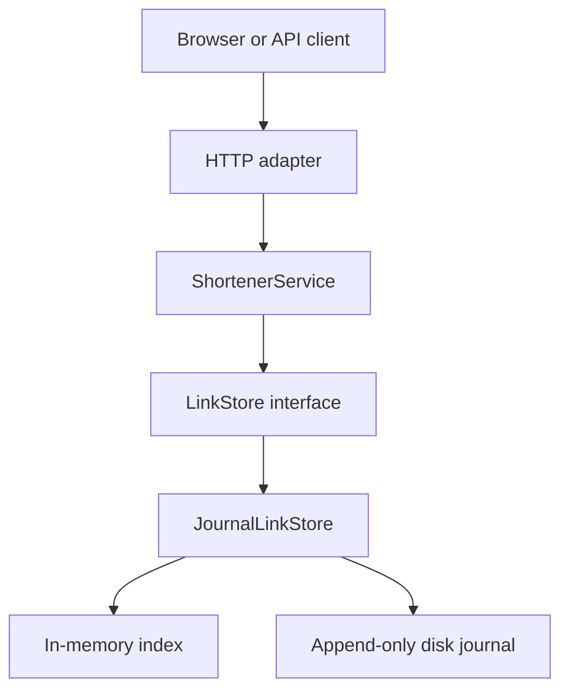

# Shortly — Java URL shortener

A runnable **Java URL shortener prototype**: create short links, inspect persistent click analytics, extend expiry, and disable links through the browser UI or API. Java 17, standard library only. No Maven, database installation, API keys, or network access needed to build or run.

## Start here — Windows

Install/use a **JDK 17 or newer** and confirm `java -version`. From this folder in PowerShell:

```powershell
powershell -ExecutionPolicy Bypass -File .\scripts\test.ps1
powershell -ExecutionPolicy Bypass -File .\scripts\run.ps1
```

Open **http://localhost:8080**. Keep the terminal open; Ctrl+C stops the service.

The downloadable ZIP also includes a prebuilt executable JAR. With Java 17+ installed, you can skip compilation and run:

```powershell
java -jar build/urlshortner.jar
```

The repository contains source; the prebuilt JAR is a convenience in the downloadable package only.

On macOS/Linux (JDK 17+):

```bash
bash scripts/test.sh
bash scripts/run.sh
```

The scripts invoke the JDK compiler module directly and compile with `--release 17 -Xlint:all -Werror`. A JRE without the compiler module is insufficient. No preview features are used. Windows scripts are supplied; execution was validated on Linux with Java 17.

## Two-minute demo

1. Create `https://example.com` with alias `interview` and no expiry.
2. Open the short link, return to the app, and refresh analytics: **1 redirect**.
3. Create the same alias again: **409 Conflict**, preserving the original destination.
4. Create another link with **1 minute** expiry; after expiry it returns **410 Gone**.
5. Stop and restart the server; look up `interview`: its URL and click count remain.

Start with [the interview walkthrough](docs/INTERVIEW.md) for the explanation and likely questions.

## Extend expiry in the UI

1. Create a link with a lifetime, or look up its code in **Link analytics** and click **Refresh**.
2. Under **Extend expiry by**, choose **1 minute**, **1 hour**, **1 day**, or **1 week**, then click **Extend expiry**.
3. The expiry timestamp updates immediately; the short URL, destination and analytics stay the same. Restarting preserves the extension.

Active links gain time from their existing expiry. Expired links are renewed from now. Disabled links cannot be renewed; links set to **Never** need no extension. The API accepts 1–31,536,000 additional seconds per request. Each successful request adds time again; after a network error, refresh and inspect the expiry before retrying.

```powershell
curl.exe -i -X PATCH http://localhost:8080/api/links/my-demo --data-urlencode "ttlSeconds=3600"
```

## Disable a link in the UI

1. Create a link, or enter its short code in **Link analytics** and click **Refresh**.
2. Click the red **Disable <code>** button and confirm the code in the confirmation dialog. Cancel leaves the link unchanged.
3. The status changes to **Disabled**, the button becomes **Link disabled**, and the click history stays visible.
4. Opening the short link now returns **410 Gone**. Restarting the app preserves the disabled state.

Disabling is permanent through this API. Editing the lookup code disables the action button until you refresh, so the action targets the link whose analytics are displayed. No terminal commands are needed for this feature.

Track this and future additions in [docs/FeatureTracker.md](docs/FeatureTracker.md).

## What works

- Random eight-character base62 codes; custom aliases; atomic uniqueness and bounded collision retry.
- Configurable expiry (1 second–365 days); expired aliases remain reserved.
- HTTP 302 redirects with no-store caching; HEAD checks do not count as clicks.
- Total redirects and last-click timestamp, retained after restart.
- Synchronized, disk-forced append journal; process file lock; incomplete-tail recovery.
- HTTP(S) URL validation, credential/newline rejection, body size limit, creation rate limit.
- Bounded worker queue, security headers, payload-free request logs, liveness endpoint.
- Browser UI, API/schema contract, regression tests, and GitHub Actions workflow.
- Brownfield enhancement: disable a link from the UI or API; retain analytics and persist the disabled state.
- Extend an existing link's expiry from the UI or API; renew expired links without changing the short URL.

## API

| Method | Endpoint | Behavior |
|---|---|---|
| POST | `/api/links` | Create; form-encoded body; returns 201 and JSON |
| GET | `/r/{code}` | Count and redirect, 302; 404 unknown; 410 expired or disabled |
| HEAD | `/r/{code}` | Resolve without counting |
| GET | `/api/links/{code}` | Metadata and analytics as JSON, including expired and disabled links |
| DELETE | `/api/links/{code}` | Permanently disable; 204 even if already disabled; 404 if unknown |
| PATCH | `/api/links/{code}` | Extend expiry using form field `ttlSeconds`; 200 with updated metadata; 409 never expires; 410 disabled |
| GET | `/health` | Process liveness; 200 `{"status":"up"}` |
| GET | `/` | Browser demo |

Creation intentionally uses the standard **`application/x-www-form-urlencoded`** format, avoiding a hand-written JSON parser. Responses are JSON. The full contract is in [docs/openapi.yaml](docs/openapi.yaml).

```bash
curl -i http://localhost:8080/api/links \
  --data-urlencode 'url=https://example.com/articles?id=42&ref=demo' \
  --data-urlencode 'alias=my-demo' \
  --data-urlencode 'ttlSeconds=3600'

curl -i http://localhost:8080/r/my-demo
curl http://localhost:8080/api/links/my-demo
```

Windows: use `curl.exe` and put each command on one line. Do not use `-L` when demonstrating the redirect response; it follows the destination.

```json
{
  "code": "my-demo",
  "shortUrl": "http://localhost:8080/r/my-demo",
  "url": "https://example.com/articles?id=42&ref=demo",
  "createdAt": "2026-10-21T12:00:00Z",
  "expiresAt": "2026-10-21T13:00:00Z",
  "clicks": 0,
  "lastClickedAt": null,
  "expired": false,
  "disabled": false
}
```

## Configuration

| Variable | Default | Purpose |
|---|---|---|
| `PORT` | `8080` | Listening port |
| `HOST` | `127.0.0.1` | Local-only by default |
| `BASE_URL` | `http://localhost:<port>` | Public origin for returned links; not inferred from untrusted Host headers |
| `DATA_FILE` | `data/links.journal` | Persistent journal; ignored by Git |

PowerShell example: `$env:PORT='8081'` then run the script. Bash example: `PORT=8081 bash scripts/run.sh`.

## Architecture and evidence



| File | Responsibility |
|---|---|
| `ShortenerServer.java` | Routing, protocol, limits, JSON responses |
| `ShortenerService.java` | Validation, IDs, expiry and business rules |
| `LinkStore.java` | Atomic storage contract |
| `JournalLinkStore.java` | Durable events, replay and thread safety |
| `Link.java` | Immutable link snapshot |
| `Ui.java` | Small same-origin browser UI |

- [Engineering decisions, task decomposition and limitations](docs/ENGINEERING.md)
- [AI assistance record and engineer review checklist](docs/AI_ASSISTANCE.md)
- [Interview walkthrough](docs/INTERVIEW.md)
- [API contract](docs/openapi.yaml)
- [Feature tracker: implementation history, demos and validation](docs/FeatureTracker.md)

**Validation:** 52 automated tests passed locally on Java 17: the original 27, 12 deactivation checks, and 13 expiry-extension checks. Coverage includes HTTP behavior, persistence, concurrency, validation and write failures. Compilation treats warnings as errors. CI is configured for Linux and Windows; remote results must be verified after publishing.

## Scope and limitations

This submission implements the **greenfield portion and small brownfield enhancements**, not the assignment's full three-scenario exercise. It demonstrates production-minded choices in a small prototype; it is **not ready for public production deployment**. No authentication, owner-level authorization, abuse screening, distributed storage, TLS termination, journal compaction or data-erasure/retention policy is included. Anyone with a code can read its analytics, extend its expiry or disable it. Bind locally for the demo. Deactivation retains data and is permanent through the API.

The journal serializes and syncs every write; this trades throughput for a clear durability model. Total redirects are not unique visitors and do not prove the destination page loaded. A crash after commit but before HTTP delivery can leave a committed operation without a received response. Health is liveness only, not disk readiness. Review [the documented next steps](docs/ENGINEERING.md) before treating this as a production design.
