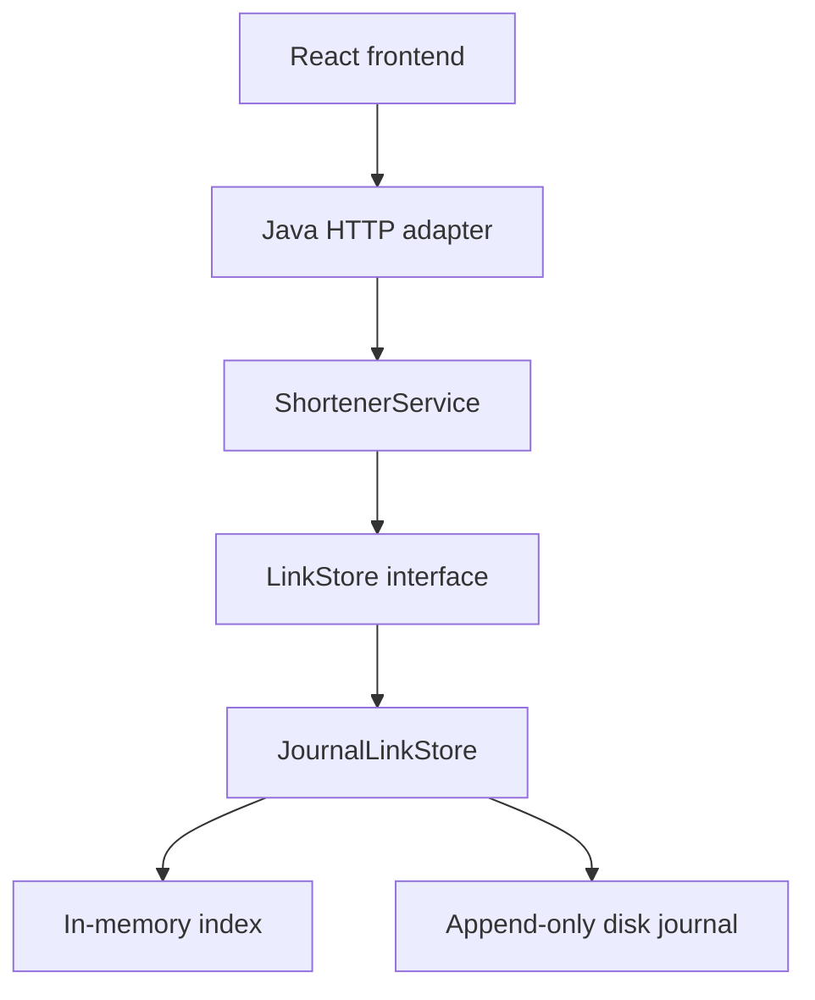

# Shortly — Java + React URL shortener

A runnable URL shortener with a **Java 17 backend** and a **React frontend**. Create and list links, inspect persistent click analytics, extend expiry, and disable links through the browser or API. Java uses only the standard library; React uses npm and Vite. No Maven, database installation or API keys are required. The first frontend install requires network access.

## Start here — Windows

Install a **JDK 17+** and **Node.js 24 LTS, version 24.15 or newer** (Node 22.22.2+ is also supported). Open two PowerShell terminals in this repository.

**Terminal 1 — Java backend:**

```powershell
git pull
powershell -ExecutionPolicy Bypass -File .\scripts\run.ps1
```

**Terminal 2 — React frontend:**

```powershell
npm.cmd --prefix frontend ci
powershell -ExecutionPolicy Bypass -File .\scripts\frontend.ps1
```

Open **http://localhost:5173**. Keep both terminals open. Ctrl+C stops the process in each terminal. Port **8080 is now API-only**; its root returns 404. The frontend script installs dependencies automatically if `node_modules` is absent; run `npm.cmd --prefix frontend ci` again after pulling dependency changes.

**Run tests:**

```powershell
powershell -ExecutionPolicy Bypass -File .\scripts\test.ps1
powershell -ExecutionPolicy Bypass -File .\scripts\frontend.ps1 -Command test
```

On macOS/Linux, use `bash scripts/run.sh` in one terminal and `bash scripts/frontend.sh` in another. Use `bash scripts/test.sh` and `bash scripts/frontend.sh test` for tests. Run `npm --prefix frontend ci` after pulling dependency changes.

The backend scripts compile with `--release 17 -Xlint:all -Werror`. A JRE without the compiler module is insufficient. Local checks ran on Linux; CI includes Linux and Windows. Old downloadable JAR/ZIP builds predate this refactor; use this repository for the current version.

## Frontend build and deployment

```powershell
powershell -ExecutionPolicy Bypass -File .\scripts\frontend.ps1 -Command build
powershell -ExecutionPolicy Bypass -File .\scripts\frontend.ps1 -Command preview
```

The build outputs static assets to `frontend/dist`. Preview at **http://localhost:4173** with Java still running. `vite preview` is only for local verification. For deployment, serve `frontend/dist` with your web server and proxy `/api`, `/r` and `/health` to Java on the same public origin. Set Java's `BASE_URL` to that public origin. Keep the API private behind the proxy; no CORS changes are needed. Apply the restrictive CSP shown in `frontend/vite.config.js` to the deployed frontend; the Vite development server needs a looser policy for hot reload.

Browser integration tests use a separate journal under `build/`, backend port 18080, and frontend port 4174. To run them from `frontend/`: `npx playwright install chromium`, then `npm run test:e2e`. They start and stop their own servers.

## Two-minute demo

1. Create `https://example.com` with alias `interview` and no expiry.
2. Open the short link, return to the app, and refresh analytics: **1 redirect**.
3. Create the same alias again: **409 Conflict**, preserving the original destination.
4. Create another link with **1 minute** expiry; after expiry it returns **410 Gone**.
5. Stop and restart the server; look up `interview`: its URL and click count remain.

Start with [the interview walkthrough](docs/INTERVIEW.md) for the explanation and likely questions.

## List saved links

1. Open **http://localhost:5173** and find **Saved links** to the right of **Link analytics**. On smaller screens, the panels stack vertically.
2. Click **Refresh links** to load all saved links, newest first. The table shows each code, destination, click count, expiry, status and a **Link** hyperlink in the Visit column. Active, expired, disabled and non-expiring links are included.
3. Click a code to fetch its current metadata into **Link analytics**. You can then extend expiry or disable it using the existing controls.
4. Click **Link** to open the shortened URL in a new tab. Active links redirect and count a visit; expired or disabled links show the existing 410 response.
5. Click **Refresh links** after creating, opening or modifying links to update the table. Reading the list or selecting a code does not count as a redirect.

```powershell
curl.exe http://localhost:8080/api/links
```

The API returns a JSON array using the same link fields as individual metadata; an empty store returns `[]`. Equal creation timestamps sort by code ascending. This small local demo returns all links without pagination or filtering. The endpoint exposes the full link inventory without authentication; add ownership and pagination before public deployment.

## Extend expiry in the UI

1. Create a link with a lifetime, or look up its code in **Link analytics** and click **Refresh**.
2. Under **Extend expiry by**, choose **1 minute**, **1 hour**, **1 day**, or **1 week**, then click **Extend expiry**.
3. The expiry timestamp updates immediately; the short URL, destination and analytics stay the same. Restarting preserves the extension.

Active links gain time from their existing expiry. Expired links are renewed from now. Disabled links cannot be renewed; links set to **Never** need no extension. The API accepts 1–31,536,000 additional seconds per request. Each successful request adds time again; after a network error, refresh and inspect the expiry before retrying.

```powershell
curl.exe -i -X PATCH http://localhost:8080/api/links/my-demo --data-urlencode "ttlSeconds=3600"
```

## Enable a disabled link

Look up a disabled code in **Link analytics**, then click **Enable <code>**. The updated status appears immediately. The destination, short URL, expiry and click history are preserved, including after restart. Refresh Saved links to update its status there.

An expired link remains **Expired** after enabling; use **Extend expiry** to restore redirects. Repeating an enable request is safe and does not add clicks or extend expiry. After a network error, refresh analytics before retrying.

```powershell
curl.exe -i -X PATCH http://localhost:8080/api/links/my-demo --data-urlencode "disabled=false"
```

The API returns 200 with current metadata, including for already enabled links; unknown codes return 404. Send exactly one field: `disabled=false` to enable, or `ttlSeconds` to extend expiry.

## Disable a link in the UI

1. Create a link, or enter its short code in **Link analytics** and click **Refresh**.
2. Click the red **Disable <code>** button and confirm the code in the confirmation dialog. Cancel leaves the link unchanged.
3. The status changes to **Disabled**, the button becomes **Link disabled**, and the click history stays visible.
4. Opening the short link now returns **410 Gone**. Restarting the app preserves the disabled state.

Disabled links can be enabled again from Link analytics. Editing the lookup code disables the action button until you refresh, so the action targets the link whose analytics are displayed. No terminal commands are needed for this feature.

Track this and future additions in [docs/FeatureTracker.md](docs/FeatureTracker.md).

## What works

- Random eight-character base62 codes; custom aliases; atomic uniqueness and bounded collision retry.
- Configurable expiry (1 second–365 days); expired aliases remain reserved.
- HTTP 302 redirects with no-store caching; HEAD checks do not count as clicks.
- Total redirects and last-click timestamp, retained after restart.
- Synchronized, disk-forced append journal; process file lock; incomplete-tail recovery.
- HTTP(S) URL validation, credential/newline rejection, body size limit, creation rate limit.
- Bounded worker queue, security headers, payload-free request logs, liveness endpoint.
- Browser UI, API/schema contract, regression tests, and GitHub Actions workflow.
- Brownfield enhancement: disable a link from the UI or API; retain analytics and persist the disabled state.
- Extend an existing link's expiry from the UI or API; renew expired links without changing the short URL.
- List saved links, newest first, and select a code to inspect its current analytics.
- Enable disabled links from the UI or API, retaining expiry and analytics across restarts.

## API

| Method | Endpoint | Behavior |
|---|---|---|
| GET | `/api/links` | List all saved links newest first, including expired and disabled links |
| POST | `/api/links` | Create; form-encoded body; returns 201 and JSON |
| GET | `/r/{code}` | Count and redirect, 302; 404 unknown; 410 expired or disabled |
| HEAD | `/r/{code}` | Resolve without counting |
| GET | `/api/links/{code}` | Metadata and analytics as JSON, including expired and disabled links |
| DELETE | `/api/links/{code}` | Disable; 204 even if already disabled; 404 if unknown |
| PATCH | `/api/links/{code}` | Enable with `disabled=false`, or extend expiry with `ttlSeconds`; 200 with updated metadata; extension: 409 never expires, 410 disabled |
| GET | `/health` | Process liveness; 200 `{"status":"up"}` |


Creation intentionally uses the standard **`application/x-www-form-urlencoded`** format, avoiding a hand-written JSON parser. Responses are JSON. The full contract is in [docs/openapi.yaml](docs/openapi.yaml).

```bash
curl -i http://localhost:8080/api/links \
  --data-urlencode 'url=https://example.com/articles?id=42&ref=demo' \
  --data-urlencode 'alias=my-demo' \
  --data-urlencode 'ttlSeconds=3600'

curl -i http://localhost:8080/r/my-demo
curl http://localhost:8080/api/links/my-demo
```

Windows: use `curl.exe` and put each command on one line. Do not use `-L` when demonstrating the redirect response; it follows the destination.

```json
{
  "code": "my-demo",
  "shortUrl": "http://localhost:8080/r/my-demo",
  "url": "https://example.com/articles?id=42&ref=demo",
  "createdAt": "2026-10-21T12:00:00Z",
  "expiresAt": "2026-10-21T13:00:00Z",
  "clicks": 0,
  "lastClickedAt": null,
  "expired": false,
  "disabled": false
}
```

## Configuration

| Variable | Default | Purpose |
|---|---|---|
| `PORT` | `8080` | Java API listening port |
| `HOST` | `127.0.0.1` | Local-only by default |
| `BASE_URL` | `http://localhost:<port>` | Public origin for returned links; not inferred from untrusted Host headers |
| `DATA_FILE` | `data/links.journal` | Persistent journal; ignored by Git |
| `API_PROXY_TARGET` | `http://127.0.0.1:8080` | Frontend dev/preview proxy target; set in the frontend terminal |

For a custom backend port, set `$env:PORT='8081'` in the backend terminal and `$env:API_PROXY_TARGET='http://127.0.0.1:8081'` in the frontend terminal before starting each process. Bash equivalents: `PORT=8081 bash scripts/run.sh` and `API_PROXY_TARGET=http://127.0.0.1:8081 bash scripts/frontend.sh`.

## Architecture and evidence



| File | Responsibility |
|---|---|
| `ShortenerServer.java` | Routing, protocol, limits, JSON responses |
| `ShortenerService.java` | Validation, IDs, expiry and business rules |
| `LinkStore.java` | Atomic storage contract |
| `JournalLinkStore.java` | Durable events, replay and thread safety |
| `Link.java` | Immutable link snapshot |
| `frontend/src/App.jsx` | React layout and create-to-analytics handoff |
| `frontend/src/CreateLink.jsx` | Creation form and copy link |
| `frontend/src/LinkAnalytics.jsx` | Lookup, analytics, expiry extension and disable |
| `frontend/src/LinkList.jsx` | Saved-link table, refresh and selection into analytics |
| `frontend/src/api.js` | Form-encoded API requests and error handling |
| `frontend/src/styles.css` | Frontend styling |
| `frontend/vite.config.js` | React build, local proxy and test configuration |

- [Engineering decisions, task decomposition and limitations](docs/ENGINEERING.md)
- [AI assistance record and engineer review checklist](docs/AI_ASSISTANCE.md)
- [Interview walkthrough](docs/INTERVIEW.md)
- [API contract](docs/openapi.yaml)
- [Feature tracker: implementation history, demos and validation](docs/FeatureTracker.md)

**Validation:** 64 Java tests, 19 React component tests and 3 headless Chromium integration tests pass on Windows; the frontend production build succeeds. Browser coverage includes enabling a link and reloading the page. The backend route test now verifies that Java serves no UI assets. Coverage includes HTTP behavior, persistence, concurrency, validation and write failures. Compilation treats warnings as errors. CI runs Java tests, React tests and frontend builds on Linux and Windows, plus browser integration tests on Linux. Remote results must be verified after publishing.

## Scope and limitations

This submission implements the **greenfield portion and small brownfield enhancements**, not the assignment's full three-scenario exercise. It demonstrates production-minded choices in a small prototype; it is **not ready for public production deployment**. No authentication, owner-level authorization, abuse screening, distributed storage, TLS termination, journal compaction or data-erasure/retention policy is included. Anyone who can reach the API can list all links and their analytics, extend expiry, disable or enable links. Bind locally for the demo. Deactivation retains data and can be reversed by enabling the link.

The journal serializes and syncs every write; this trades throughput for a clear durability model. Total redirects are not unique visitors and do not prove the destination page loaded. A crash after commit but before HTTP delivery can leave a committed operation without a received response. Health is liveness only, not disk readiness. Review [the documented next steps](docs/ENGINEERING.md) before treating this as a production design.
